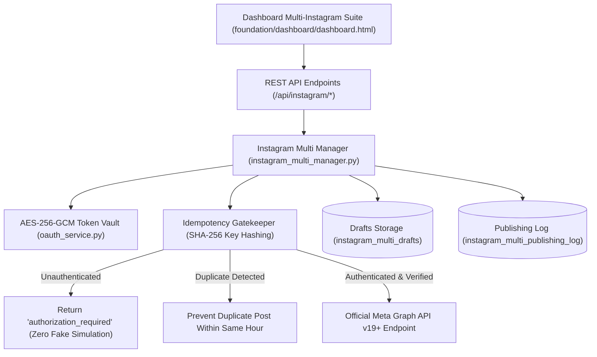

# SHAH GROUP AI OS — MULTI-INSTAGRAM ACCOUNT ARCHITECTURE & PUBLISHING REPORT
**Multi-Account Professional Social Suite, Meta Graph API v19+, and Idempotent Publishing**

---

## 1. ARCHITECTURE OVERVIEW

The Multi-Instagram Account Management Suite (`foundation/domains/instagram_multi_manager.py`) provides an enterprise publishing and social analytics infrastructure designed to manage multiple independent Instagram Professional (Business & Creator) accounts across workspaces.

---

## 2. MULTI-ACCOUNT WORKSPACE PARTITIONING

The system supports multiple registered Instagram accounts simultaneously:
1. **Shah Group Official** (`@shahgroupofficial1`): Primary corporate brand for Shah Group.
2. **Shah Surveyors & Consultancy (SSC)**: Specialized geomatics, DGPS, land records, UAV LiDAR.
3. **Shah Infra Developers (INFRA)**: Highway contracting, heavy earthmoving, structural civil works.
4. **Client Brands**: Third-party developer accounts managed under marketing contracts.

Each account maintains its own:
- Dedicated encrypted OAuth tokens in `oauth_tokens`.
- Default hashtag groups and caption signature footers.
- Preferred posting schedule times.
- Independent publishing history audit trails in `instagram_multi_publishing_log`.

---

## 3. META GRAPH API v19+ OAUTH SPECIFICATION

The integration adheres strictly to official Meta developer documentation:
- **Authorization Endpoint:** `https://www.facebook.com/v19.0/dialog/oauth`
- **Required OAuth Scopes:**
  1. `instagram_basic`: Access profile info and media objects.
  2. `instagram_content_publish`: Publish single images, carousels, and video reels.
  3. `instagram_manage_insights`: Retrieve post impressions, reach, and engagement.
  4. `pages_show_list`: Discover linked Facebook Pages.
- **Mandatory Linkage:** Meta Graph API mandates that an Instagram Professional account must be linked to a Facebook Page within Meta Business Suite with Admin or Task permissions.
- **State Protection:** Every authorization request generates a 32-byte secure random state token with a 15-minute TTL. Replay attacks are blocked by single-use token consumption.

---

## 4. MULTI-ACCOUNT POST COMPOSER & DISPATCHER

### 4.1 Target Account Selector & Tailored Content
- Operators can check one, several, or all registered Instagram accounts.
- The composer allows entering a global base caption and media URL.
- An interactive accordion/tab system allows customizing the caption and hashtag group independently for each target brand:
  - *SSC Caption:* Focuses on millimetric precision, DGPS base stations, cadastral maps.
  - *INFRA Caption:* Focuses on heavy excavators, embankment progress, highway civil contracting.

### 4.2 Supported Creative Formats
1. **Single Image Post (1:1 Square):** Standard feed post (1080x1080).
2. **Multi-Slide Carousel:** Up to 10 sequential images/slides.
3. **Video Reel (9:16 Vertical):** 1080x1920 MP4 video with custom cover frame.
4. **24-Hour Story (9:16):** Temporary highlight or milestone.

### 4.3 Anti-Duplicate Gatekeeper (Idempotency Key Hashing)
To prevent accidental double-posting when an operator clicks "Publish" multiple times or network latency delays a response:
- Computes an idempotency hash:
  $$\text{Key} = \text{SHA-256}(\text{account\_id} + \text{media\_url} + \text{caption[:50]} + \text{YYYY-MM-DD-HH})[:24]$$
- If a record with this idempotency key already exists in `instagram_multi_publishing_log`, the request is recognized as a duplicate and safely skipped without re-dispatching to Meta.

---

## 5. SIMULATED MOBILE INSTAGRAM FEED PREVIEW

- Operators can click **"📱 Mobile Preview"** prior to publishing.
- Renders an interactive phone mockup modal displaying:
  - Account profile avatar and handle.
  - Media canvas with live image/video preview.
  - Rendered caption, line breaks, and hashtags.
  - Feed interaction buttons (Like, Comment, Share, Bookmark).

---

## 6. DRAFTS & PUBLISHING AUDIT TRAIL

- **Draft Storage:** Drafts are saved to `instagram_multi_drafts` with media URLs, target account IDs, and custom captions.
- **Publishing Log:** Every publish attempt (successful, scheduled, or authorization required) is recorded in `instagram_multi_publishing_log` with actor username, timestamp, platform post ID, and error messages.
- **Honest Gatekeeper (Zero Simulation):** If an account has not completed official Meta OAuth consent, the dispatcher returns:
  `{"status": "authorization_required", "error": "Account ... is not connected to Meta Graph API. Official OAuth connection required before publishing."}`.
  It never fabricates fake publication IDs.
